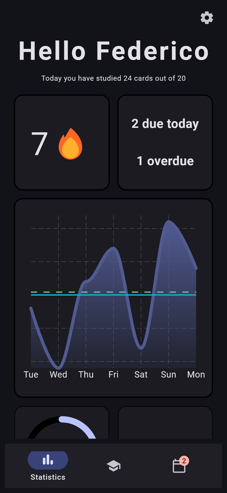
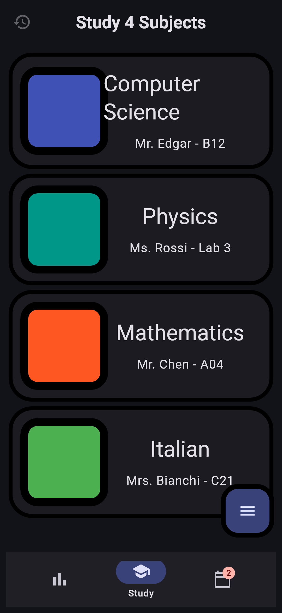
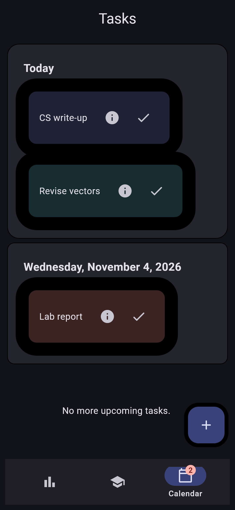

# Study App

A cross-platform study companion built with **Flutter** and **Firebase**. You can organise subjects into topics and flashcards, take tests with typo-tolerant grading, track a daily study streak and keep on top of homework, all synced to the cloud.

<p align="center">
  
  &nbsp;
  
  &nbsp;
  
</p>

<p align="center">
  
  
  
  
</p>

## Features

**Flashcards and studying**
- Organise material as **Subjects → Topics → Flashcards**, with a colour, teacher and classroom for each subject
- Flip through cards in study mode and mark each one as learned or unlearned
- See per-subject progress based on the share of cards learned

**Testing**
- Generate tests from all subjects, a single subject, or a single topic
- Answers are graded with **fuzzy string matching** (Levenshtein ratio > 80%), so small typos still count as correct
- Look back at past tests, review each answer you gave against the correct one, and override a marking if needed

**Progress tracking**
- Set a daily card goal and build up a **streak** 🔥 by meeting it
- A **weekly activity chart** (built with `fl_chart`) plots cards studied against your goal and your weekly average
- Average test scores are shown for your last 10 tests and overall

**Tasks and calendar**
- Create colour-coded tasks with descriptions and due dates
- Tasks are grouped by day (Today, Tomorrow, then dated), and the nav bar shows a badge with the number due today

**Personalisation and accounts**
- Email/password sign-up and login with **Firebase Authentication**
- All data is stored per user in **Cloud Firestore**, so it syncs across devices
- Choose a custom accent colour or **use the device's Material You colour**, in light or dark mode

## Tech stack

| Area | Technology |
| --- | --- |
| UI | Flutter, Material 3 (`ColorScheme.fromSeed`, `dynamic_color`) |
| Backend | Firebase Auth, Cloud Firestore |
| Charts | `fl_chart` |
| Answer grading | `fuzzywuzzy` |
| Platforms | Android, Windows (Firebase configured); the Flutter scaffolding for iOS, macOS, Linux and web is also present |

## Project structure

```
lib/
├── main.dart              # App entry, theming, bottom-nav shell
├── data_managers/         # Firestore sync, user preferences, test bookkeeping
├── states/                # Plain data models: Subject, Topic, FlashCard, Task, Test
├── pages/                 # Screens: login, stats, subjects, study, test, results, calendar
├── widgets/               # Reusable UI: subject/topic/day cards, chart, task popup
└── utils/                 # Dialogs, expandable FAB, page transitions, helpers
```

There is a class diagram in [`out/uml/uml.svg`](out/uml/uml.svg), generated from [`uml.pu`](uml.pu).

## Getting started

**Prerequisites:** the [Flutter SDK](https://docs.flutter.dev/get-started/install) (Dart ≥ 3.4) and a Firebase project.

```bash
git clone https://github.com/fedqq/Flutter-Study-App.git
cd Flutter-Study-App
flutter pub get
```

To use your own backend, enable **Email/Password** auth and **Cloud Firestore** in your Firebase project. Then regenerate the config:

```bash
dart pub global activate flutterfire_cli
flutterfire configure
```

Then run the app:

```bash
flutter run            # pick an Android device/emulator or Windows
```

## Background

I built this app as a Computer Science school project. It started with local storage and was later moved to Firebase to get cloud sync and accounts. Most of the later work went into refactoring so the code passes a strict lint ruleset (`analysis_options.yaml`).

---

*The screenshots use sample data.*
